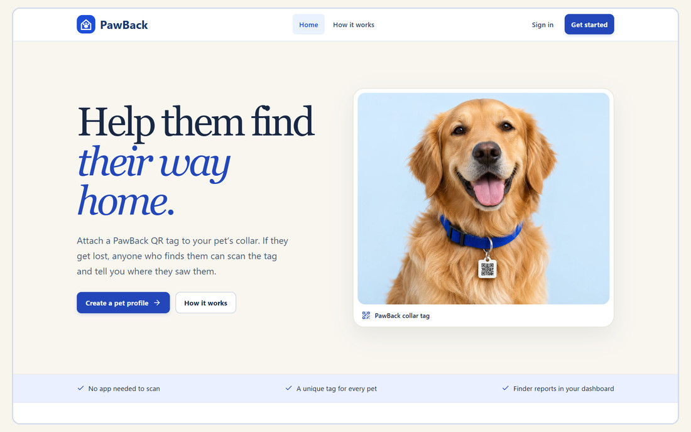
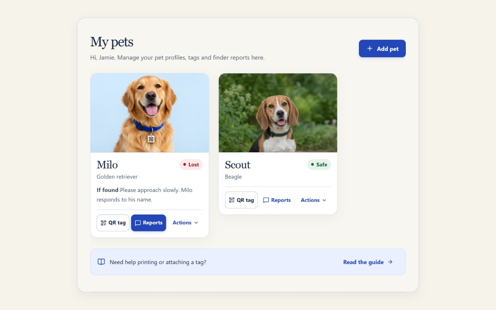
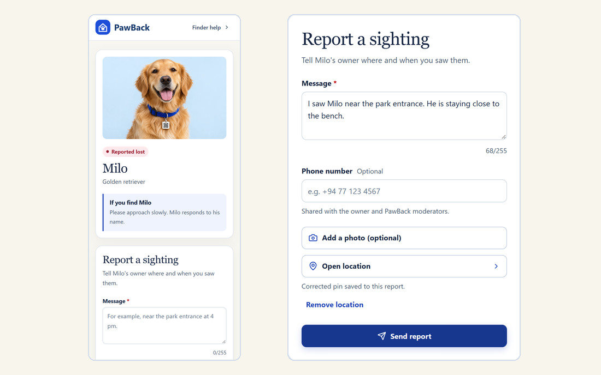
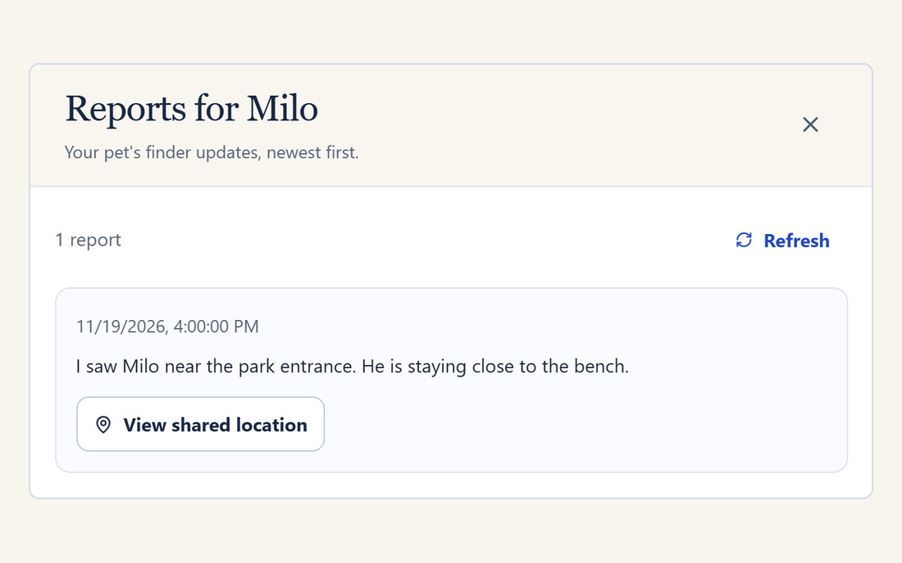

# PawBack

PawBack helps reunite lost pets with their owners. Owners can create a pet profile and attach a printable QR tag to their pet's collar. Anyone who finds the pet can scan the tag with a phone camera, view the pet's profile, and send the owner a sighting report.

[Open PawBack](https://pawback.duckdns.org/) · [Watch the video demo](https://youtu.be/M3tMdFTfyaw?si=5Zy40g-NT0lzLwZZ)

## Screenshots

| Home | My pets |
| --- | --- |
| [](assets/home.jpg) | [](assets/my-pets.jpg) |
| **Finder view** | **Owner reports** |
| [](assets/finder-view.jpg) | [](assets/owner-reports.jpg) |

Pet profiles and reports shown here use demo data. Select any screenshot to view it at full size.

## Features

- **Pet profiles and QR tags.** Add a photo, pet details, and instructions for finders. Download a QR tag for each pet.
- **Safe and Lost status.** Update a pet's status from the owner dashboard. When a pet is marked Lost, finders can submit a report from the public QR profile without signing in.
- **Sighting reports.** Finders can include a photo, map location, or callback number. Owners receive an email notification and can view report details in the dashboard.
- **Account access and moderation.** Owners can sign in with a password or Google. Administrators can manage users and review finder reports.

## Tech stack

| Layer | Technology |
| --- | --- |
| Frontend | React, Vite, Tailwind CSS, Leaflet |
| Backend | Java 21, Spring Boot, Spring Security, Spring Data JPA |
| Database | MySQL |
| Integrations | Google OAuth, Cloudinary for images, Brevo for email, ZXing for QR generation |

## Run locally

Install **Java 21**, **Node.js 22.17 or later** with npm, and **MySQL 8.0 or later**. The repository includes the Maven wrapper.

Start MySQL and create an empty database named `pawback`. Hibernate initializes the application tables when the backend starts.

Set the following environment variables before starting the backend. On Windows, save them as user environment variables and open a new terminal to load them. The backend reads them through [application.properties](backend/src/main/resources/application.properties).

| Variables | Values |
| --- | --- |
| `DB_URL`, `DB_USERNAME`, `DB_PASSWORD` | Your MySQL JDBC URL, username, and password. The default URL points to `localhost:3306/pawback` and the default username is `root`. |
| `JWT_SECRET` | A random signing secret. The command below generates one as Base64 text. |
| `CLOUDINARY_CLOUD_NAME`, `CLOUDINARY_API_KEY`, `CLOUDINARY_API_SECRET` | Your Cloudinary credentials. |
| `GOOGLE_CLIENT_ID`, `GOOGLE_CLIENT_SECRET` | Credentials for a Google OAuth web application. |
| `PAWBACK_BREVO_API_KEY`, `PAWBACK_BREVO_SENDER_EMAIL` | Brevo API key and verified sender address for password reset and report emails. |

For Google sign-in, set `http://localhost:5173` as an authorized JavaScript origin and `http://localhost:8080/login/oauth2/code/google` as an authorized redirect URI.

To generate a JWT secret in PowerShell and use it in the current terminal, run the following command. Store credentials privately.

```powershell
$pawbackBytes = New-Object byte[] 64
$pawbackRng = [System.Security.Cryptography.RandomNumberGenerator]::Create()
$pawbackRng.GetBytes($pawbackBytes)
$pawbackRng.Dispose()
$env:JWT_SECRET = [Convert]::ToBase64String($pawbackBytes)
```

Start the backend from the repository root.

```powershell
cd backend
.\mvnw.cmd spring-boot:run
```

On macOS or Linux, use `sh ./mvnw spring-boot:run` from the `backend` directory.

In a second terminal, start the frontend from the repository root.

```sh
cd frontend
npm ci
npm run dev
```

Open [localhost:5173](http://localhost:5173/). The backend runs on port `8080` by default.
